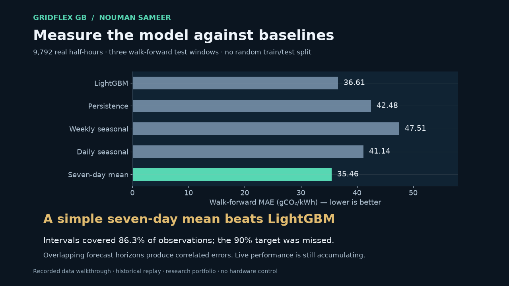
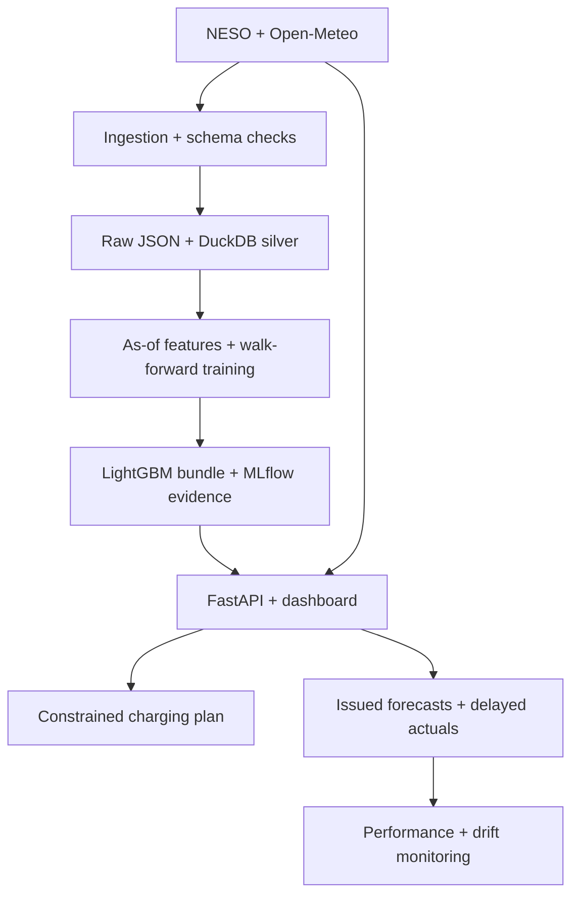

# GridFlex GB

**Forecast GB electricity carbon intensity and schedule EV or battery charging around it.**

An independent portfolio project by **Nouman Sameer**, connecting electrical engineering, data science and energy operations. It retrieves real NESO and Open-Meteo data, evaluates a 24-hour LightGBM forecast, and serves a charging planner through FastAPI and a responsive dashboard.

**Public demo:** [GridFlex GB](https://nouman-gridflex-gb.nimblepeony1.chatgpt.site) serves live baseline forecasts and charging plans on Cloudflare Workers. The Python FastAPI/Azure path remains separate; Azure is not deployed. Long-term prospective performance is still to be established. See [deployment and API notes](docs/PUBLIC_DEMO.md).

**Audit decision:** keep LightGBM as a research candidate. The seven-day clock-time average has lower error, and intervals miss their nominal coverage. See the [strict review and resolved findings](docs/AUDIT.md). This is an AI-assisted independent portfolio build, not commercial delivery or an assessed university result.

[Watch the 28-second data walkthrough](docs/assets/gridflex-walkthrough.mp4) · [Recorded dashboard snapshot](docs/demo-snapshot.html) · [Verification and remaining activation steps](docs/VERIFICATION.md)



## Measured evidence

The committed reference dataset contains **9,792 half-hour observations**, from **1 March through 20 September 2026**. Source checks found **zero missing intervals and zero missing actuals** in this training snapshot.

| Model | Walk-forward MAE ↓ | RMSE ↓ |
|---|---:|---:|
| LightGBM | 36.61 | 45.49 |
| Persistence (last eligible actual) | 42.48 | 54.03 |
| Weekly seasonal | 47.51 | 58.87 |
| Daily seasonal (latest eligible matching time) | 41.14 | 51.92 |
| Seven-day clock-time mean | **35.46** | **43.28** |

Errors are in **gCO₂/kWh**. LightGBM beats persistence but loses to the stronger seven-day mean (36.61 versus 35.46). Nominal 90% intervals achieved **86.3% coverage**; their mean width was **141.65 gCO₂/kWh**. The candidate fails the revised gate. Added diagnostics do not change the fitted weights, hyperparameters or calibration radius. A paired seven-day block bootstrap gives an exploratory MAE difference interval of −6.77 to +7.50, so no robust superiority claim is supported.

Across 168 historical charging simulations with the fixed default battery, the forecast-based schedule's observed average-intensity proxy was **30.75% below immediate charging in aggregate**. It improved on immediate charging in **88.10%** of overlapping scenarios. These are simulated outcomes, not measured physical charging or avoided emissions. [Full diagnostics and baseline schedules](docs/evidence/scientific-audit.json).

Read the [fold results](docs/evidence/RESULTS.md), [machine-readable model card](models/production/model_card.json), [source manifest](docs/evidence/data_manifest.json), [MLflow run export](docs/evidence/mlflow_runs.json), and [individual scored forecasts](docs/evidence/backtest_predictions.csv.gz). No generated test data is used in those measurements.

## Later holdout and release decision

A frozen residual LightGBM candidate was tested on **960 additional observations** from 21 September–10 October 2026. Development MAE improved from 35.46 to 33.59, but later MAE was **46.73**, against **46.22** for the strongest later baseline (persistence); nominal 90% interval coverage was **82.4%**. The promotion gate failed. The original LightGBM achieved 45.95 MAE with only 78.6% coverage. These are retrospective results, not live operating performance. [Protocol, models, raw snapshots and every prediction](reports/temporal_holdout).

## Run it

Python 3.12 is the tested runtime. From this project directory:

```bash
python -m venv .venv
source .venv/bin/activate
# Windows PowerShell: .venv\Scripts\Activate.ps1
pip install -r requirements-runtime.lock
pip install --no-deps -e .
gridflex serve
```

Open **http://localhost:8000** for the dashboard and **http://localhost:8000/docs** for interactive API documentation. The bundled historical replay works without internet access or credentials. Select **Live forecast** to use current NESO data. Live mode reports an error if its source or required history is unavailable; it never relabels replay data as current.

```bash
docker compose up --build
# Run one ingestion / forecast / monitoring cycle:
docker compose --profile maintenance run --rm maintenance
```

## What is implemented

- Live NESO carbon data and three-location Open-Meteo weather context, with retries and bounded timeouts.
- Immutable raw JSON snapshots with content hashes; validated, idempotent DuckDB silver tables; reproducible feature CSVs.
- Direct 48-step LightGBM forecasts, four simple baselines, purged walk-forward evaluation and split-conformal intervals.
- MLflow experiments with a SQLite backend, data/model fingerprints and exported run evidence.
- Charge-only optimisation for carbon, a supplied tariff, or a balanced normalised objective, with power, energy, efficiency and deadline constraints.
- FastAPI, responsive dashboard, downloadable CSV, structured logs, health/readiness probes and Prometheus metrics.
- Scheduled ingestion, issued-forecast storage, delayed-label performance checks and PSI drift alerts.
- Docker, GitHub Actions and Terraform for Azure Container Apps, a scheduled job, persistent Azure Files and log alerts.

## Architecture



The cloud configuration shares a persistent volume between the API and a scheduled maintenance job. GitHub Actions supplies a separate demonstration of scheduled pipeline operation. See [architecture](docs/ARCHITECTURE.md) and [operations](docs/OPERATIONS.md).

## Reproduce the experiment

```bash
pip install -r requirements-dev.lock
pip install --no-deps -e .
gridflex train --input data/reference/carbon.csv --output artifacts/reproduced --data-kind real --track
mlflow server --backend-store-uri sqlite:///mlflow.db --host 127.0.0.1 --port 5000
```

The reference CSV is supplied so a reviewer can reproduce the experiment without waiting for a network backfill. To collect independently:

```bash
gridflex ingest --start 2026-03-01T00:00:00Z --end 2026-09-21T00:00:00Z --weather
gridflex train --input data/processed/carbon.csv --output artifacts/new-candidate --data-kind real --track
```

Requests are split into at most 14-day carbon windows. Historical weather is reanalysis and can be delayed; choose an archive end date at least five days in the past. The current model **does not use weather features**: historical reanalysis would not substitute for archived, as-issued weather forecasts in an operational backtest. Weather is collected, validated and presented as context for a future properly controlled experiment.

## API examples

```bash
curl http://localhost:8000/api/v1/forecast?mode=replay
curl http://localhost:8000/api/v1/forecast?mode=live
curl -X POST http://localhost:8000/api/v1/schedule \
  -H 'Content-Type: application/json' \
  -d '{"mode":"replay","capacity_kwh":60,"initial_soc":0.3,"target_soc":0.8,"max_charge_kw":7,"efficiency":0.9,"available_slots":48,"objective":"carbon"}'
```

| Route | Purpose |
|---|---|
| `/health`, `/ready` | Process liveness and model readiness |
| `/api/v1/forecast` | 48 predictions, intervals, issue time and provenance |
| `/api/v1/schedule` | Feasible charge-only plan and immediate-charge comparison |
| `/api/v1/model` | Full evaluation and model card |
| `/api/v1/weather` | Current weather context for three GB locations |
| `/api/v1/monitoring` | Latest scheduled drift/performance report |
| `/api/v1/forecast.csv` | Downloadable forecast data |
| `/metrics` | Prometheus request counts and latency |

For a plan or CSV that must match the displayed forecast, pass its `forecast_id` as `expected_forecast_id`. A changed forecast returns HTTP 409. The dashboard does this automatically.

## Validation

```bash
ruff check src tests scripts
ruff format --check src tests scripts
pytest --cov=gridflex --cov-report=term-missing
terraform -chdir=infra/terraform init -backend=false
terraform -chdir=infra/terraform validate
```

Tests cover corrupted schemas, revisions, future-data leakage, observation delay, DST, split boundaries, model checksums, real MLflow logging, infeasible schedules, negative tariffs, drift, and HTTP failure behaviour. The balanced optimiser is compared with an independently solved linear programme.

For the dashboard integration check, keep `gridflex serve` running in a separate terminal, then run `npm ci --ignore-scripts && npm run test:ui` with Node 22 or newer. This checks the shipped JavaScript against the running API, including invalid requests. GitHub Actions runs the same check against the built Docker container. Local test results and external checks still awaiting execution are distinguished in [verification](docs/VERIFICATION.md).

## Deployment and review

Follow [the Azure deployment guide](docs/DEPLOYMENT.md). It specifies the required account setup, container publication, Terraform plan/apply, health verification, teardown and cost controls. No Azure account, subscription, identity or billing configuration is embedded in this repository.

The [model card explanation](docs/MODEL_CARD.md) distinguishes retrospective evaluation from live evidence. The [demo guide](docs/DEMO.md) gives a short reviewer walkthrough. [Security](SECURITY.md) and [data attribution](NOTICE.md) describe the system boundary and data licences.

## Scope limits

This covers **Great Britain**, not Northern Ireland. Carbon is average grid intensity, not marginal emissions. Charging is divisible and charge-only: there is no discharge arbitrage, degradation model, household demand constraint, hardware integration or commercial stakeholder claim. Cost optimisation requires the user's tariff; no fictitious live price feed is used. The project does not establish that charging changes cause measured emissions savings.

Code: MIT. Data and source attribution: [NOTICE.md](NOTICE.md).
